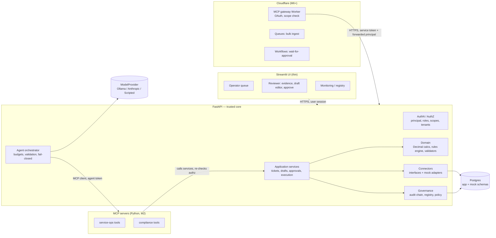
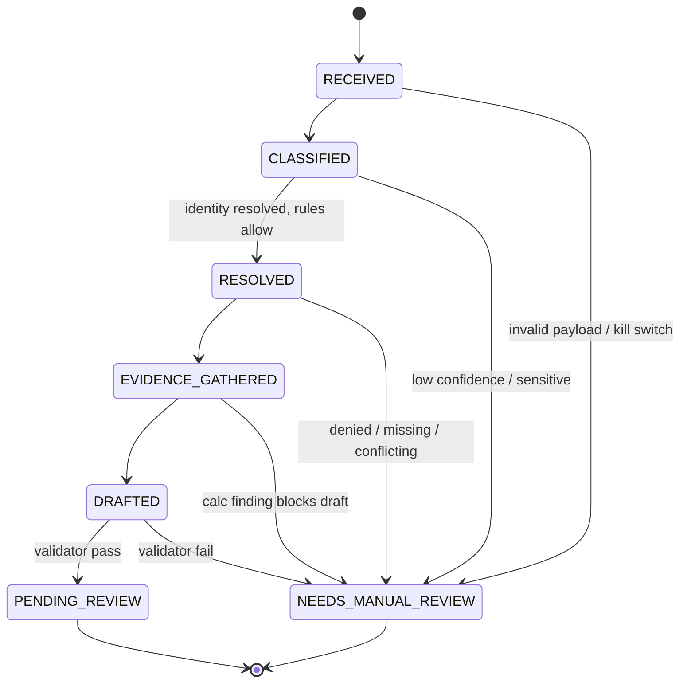
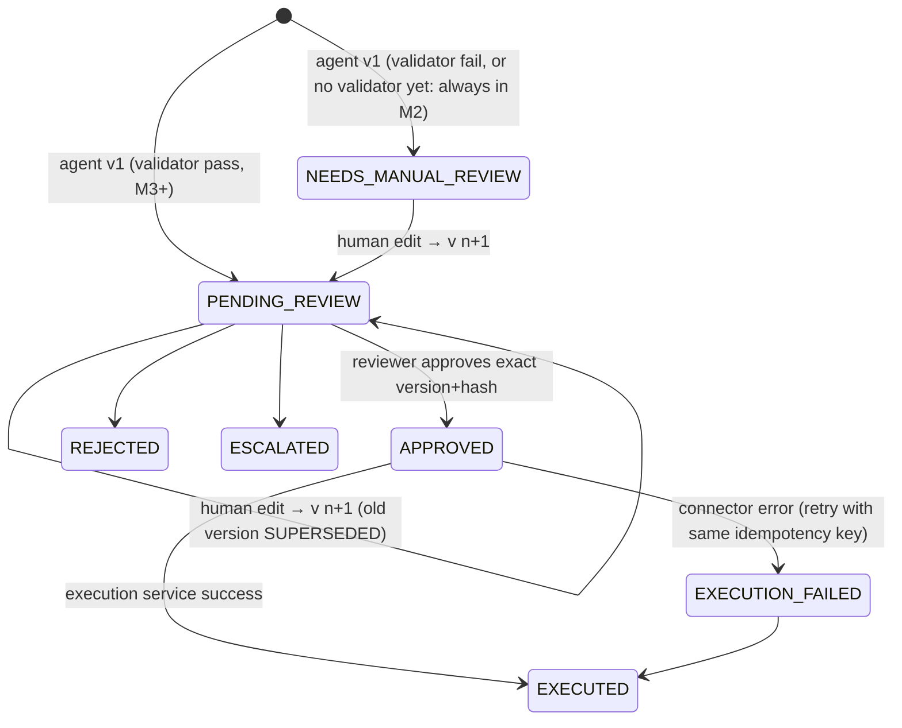

# Architecture

> Prototype on synthetic data. Not production software, and not compliant with ERISA, IRS rules, SOC 2,
> GLBA or any other regulation. A real deployment needs legal, security, privacy, architecture and
> vendor-risk review.

Decisions and their trade-offs are recorded in [`adr/`](adr/README.md). This page gives the overall
picture.

## 1. Component view



### Layering rule (enforced by import-linter from Milestone 1)

```
api / mcp_servers / ui   →  services  →  domain
                            services  →  connectors (interfaces)  →  adapters
agent_runtime            →  mcp_client (never connectors or adapters directly)
domain                   →  (nothing: pure, no I/O)
```

The agent runtime can reach business data **only** through MCP tools. It has no in-process shortcut to
connectors, so every agent data access passes the same authorisation checks as an external MCP client.

## 2. Identity and authorization model

### Principals and roles

| Role | Human? | Purpose |
|---|---|---|
| `operator` | Yes | Views queue and tickets, starts runs, picks up manual triage |
| `reviewer` | Yes | Approves, edits, rejects or escalates service drafts and assignment proposals |
| `compliance_reviewer` | Yes | Approves compliance drafts and vendor exceptions |
| `admin` | Yes | Kill switch, registry edits, user and tenant assignment. **Cannot approve drafts.** |
| `agent_service` | No | AI worker. Read tools plus create drafts and proposals. **Never approve.** |
| `svc-*` connector identities | No | Used by adapters. Writer identity used only by the execution service. |

### Scopes

| Scope | operator | reviewer | compliance_reviewer | admin | agent_service |
|---|:-:|:-:|:-:|:-:|:-:|
| `tickets:read` | ✓ | ✓ | | | ✓ |
| `plans:read` | ✓ | ✓ | | | ✓ |
| `payroll:read` | ✓ | ✓ | | | ✓ |
| `payroll:ingest` | ✓ | | | | |
| `drafts:write` | ✓ | ✓ | | | ✓ |
| `review:approve` | | ✓ | | | **✗** |
| `compliance:read` | | | ✓ | | ✓ (compliance runs only) |
| `compliance:draft` | | | ✓ | | ✓ (compliance runs only) |
| `compliance:approve` | | | ✓ | | **✗** |
| `admin:ops` | | | | ✓ | |

`compliance:approve` is added to the spec's scope list so that compliance approval is not the same
permission as service approval. Service-ops policy snippets (M2) are read with `tickets:read`. `payroll:ingest` (operators only) covers synthetic payroll file
upload. `tests/unit/test_authz_matrix.py` parses this table and fails if it drifts from
`domain/authz.py`.

### Agent run tokens

The host mints a **run-scoped token** for each agent run. It carries:

- `sub = agent_service`, `run_id`, `correlation_id`
- `tenant_id`, which the **host** derives from the ticket's Zendesk organisation. The model never supplies it.
- the minimum scopes the skill needs
- a short expiry (default 10 minutes)

Tools take **no `tenant_id` argument**. Every tool loads the target object and checks
`object.tenant_id == token.tenant_id` and the required scope. A mismatch returns `403`, writes an audit
event and is counted as a denied call.

Locally (M1 to M5) tokens are signed JWTs from a dev key in `.env` (mock identity, **not production
SSO**). In M6 the Cloudflare Worker uses the Workers OAuth Provider for MCP clients and forwards a
verified principal to the API over an authenticated channel. The API validates again (ADR-008).

## 3. State machines

These are the transitions the tests must cover. Any transition not listed is rejected.

### Agent run



Any exception, timeout, budget overrun or malformed model output moves the run from its current state to
`NEEDS_MANUAL_REVIEW`.

### Draft (versioned, immutable versions)



A human edit re-runs the host validator on the new body. A failed validator shows warnings but does not
block a human approver, because the human is accountable for the text. **Exception:** a monetary value in
an edited draft that does not match the finding is a hard block. See [threat-model](threat-model.md)
T-07.

### Action proposal (assignment)

`PROPOSED → APPROVED → EXECUTED` or `PROPOSED → REJECTED`, with the same version, hash and idempotency
rules. Only queues from the routing config are valid targets.

## 4. Approval and execution checks (server-side, in order)

1. Principal is human, has `review:approve` (or `compliance:approve`), and is assigned to the draft's tenant.
2. Principal is not `agent_service`, and the request does not carry an agent run token.
3. Draft `version` and `content_hash` in the request equal the current version in the DB.
4. Draft status is `PENDING_REVIEW`.
5. The ticket's current `updated_at` or version equals the one captured in the evidence bundle. Otherwise the draft is stale.
6. No unresolved blocker findings (or the reviewer explicitly acknowledges each non-monetary one).
7. Draft is not expired (default 72 hours).
7a. Four-eyes: if the draft is sensitive, the approver authored no version of it (ADR-007).
8. The idempotency key `(draft_id, version, action)` is unused. If it is used, the stored result is returned.
9. Kill switch is off.

Then the execution service, using `svc-zendesk-writer`, calls `TicketConnector.post_public_reply` or
`apply_assignment` and writes an audit event (approver, action, target, before and after refs,
version/hash, correlation ID, result).

## 5. Model boundary

| LLM does | Deterministic code does |
|---|---|
| Classify intent and urgency (structured output) | Confidence thresholds, routing, risk rules |
| Choose among the allowed tools and their arguments | Validate tool name, args, count, size, sequence, tenant, scope |
| Explain evidence in plain language and draft a reply | All arithmetic, rounding, effective-date selection |
| Summarise vendor findings, draft exception narrative | Vendor checks (overdue, missing SOC, stale evidence) |
| Draft questionnaire answers from retrieved passages | Citation existence and version effectiveness checks |

## 6. Repository layout (proposed; see ADR-002)

```text
retirementops/
  README.md  CLAUDE.md  pyproject.toml  uv.lock  docker-compose.yml  .env.example  .mcp.json.example
  docs/                      # this folder; adr/ holds decisions
  src/retirementops/
    domain/                  # pure: money, rules, calculations, validators, state machines
    connectors/              # interfaces + mock adapters (one module per mock system)
    services/                # application services: tickets, drafts, approvals, execution
    api/                     # FastAPI routes, auth dependencies
    store/                   # RetirementOps workflow records: drafts, proposals (app schema)
    mcp_servers/             # service_ops/ (M2); compliance/ (M7) — separate registries and scopes
    mcp_client/              # client used by agent_runtime
    agent_runtime/           # providers, orchestrator, skill loader, guardrails
    governance/              # audit chain, asset registry, policy, kill switch
    evaluations/             # runner, scorers, reports
    ui/                      # Streamlit app (calls api over HTTP)
  cloudflare/                # M6+: mcp-gateway/ (TS Worker), workflows/, wrangler.jsonc
  skills/                    # runtime business skills (worker instructions)
  .claude/skills/            # developer skills for Claude Code (not runtime)
  migrations/                # Alembic
  data/synthetic/  data/golden/  evals/cases/  evals/reports/
  scripts/                   # seed generator, eval runner entrypoints
  tests/unit/  tests/integration/  tests/security/  tests/evals/
```
