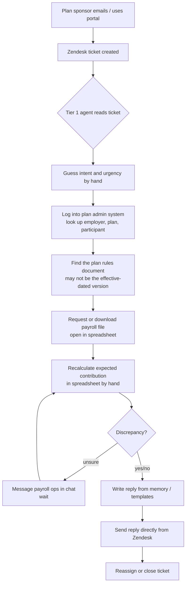
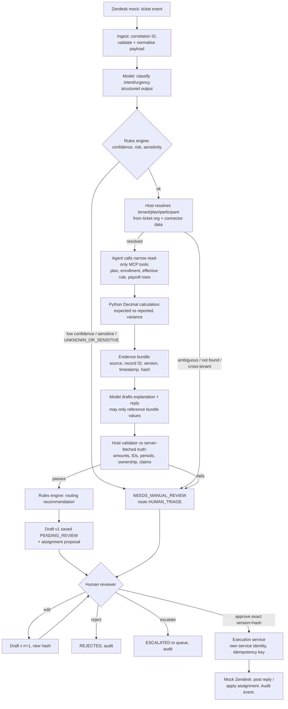
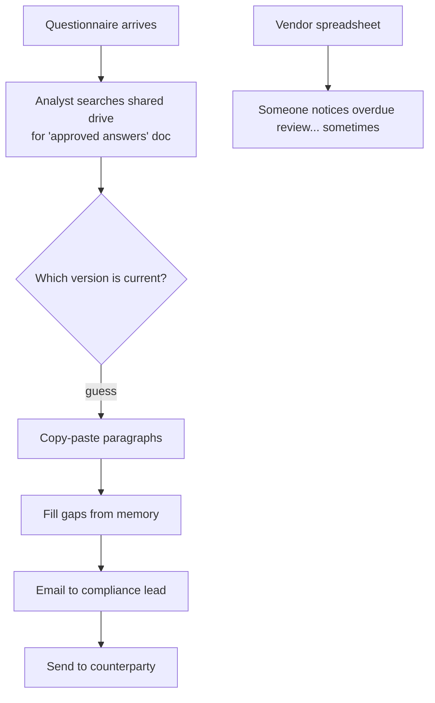
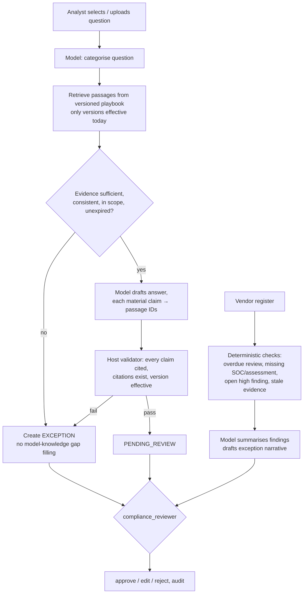

# Business Process: As-Is and To-Be

> **Synthetic simulation.** Every organisation, plan, participant, rule, volume and system in this
> document is fictional. Nothing here is legal, ERISA, IRS, investment or compliance advice.
> Where a real deployment would need measured numbers, this document says *"to be measured in
> discovery"* rather than inventing them.

---

## 1. Business context

A fictional retirement-savings record-keeper ("the provider") administers workplace savings plans for
employers ("plan sponsors"). Two teams do repetitive, evidence-heavy work:

| Team | Work | Why it is slow today |
|---|---|---|
| **Workplace Savings Service Operations** | Answers plan-sponsor tickets about contributions, enrollment, eligibility, plan rules, payroll files and portal access. | Each answer needs evidence from three or more systems, and agents compare it by hand. |
| **Legal & Compliance** | Answers due-diligence and audit questionnaires; oversees third-party vendors. | Approved language sits in a long playbook. Answers are copied by hand, and citations and version checks are inconsistent. |

### Stakeholders (fictional roles)

| Role | Interest |
|---|---|
| Plan sponsor HR / payroll administrator | Gets a correct, timely answer. Is the external requester. |
| Service operations agent (Tier 1) | Triages, investigates and drafts replies. Called the **operator** in the system. |
| Service operations reviewer / team lead | Approves outbound replies and routing. Called the **reviewer**. |
| Payroll operations specialist | Owns contribution discrepancies once routed. |
| Compliance analyst | Drafts questionnaire answers. |
| Compliance reviewer | Approves questionnaire answers and vendor exceptions. Called the **compliance_reviewer**. |
| Head of Service Operations | Business owner of the service AI worker. |
| Head of Compliance | Business owner of the compliance AI worker. |
| Platform engineering | Engineering owner of RetirementOps. |

---

## 2. Primary workflow: contribution discrepancy ticket

### 2.1 As-is

**Pain points (qualitative; magnitudes to be measured in discovery)**

1. **Swivel-chair lookups.** An agent opens three or four systems for each ticket. Handle time and SLA
   misses are to be measured.
2. **Spreadsheet arithmetic.** Expected contributions are recalculated by hand, so rounding and
   effective-date mistakes happen.
3. **Wrong rule version.** Agents can apply the current plan rule to an older pay period.
4. **No evidence trail.** A reply rarely records which payroll rows or rule version backed it.
5. **Inconsistent routing.** Tickets bounce between queues.
6. **No checkpoint.** A single agent can send an external reply and close a ticket with open questions.
7. **Cross-tenant risk.** One agent's tools can reach every employer. Nothing stops a lookup against the
   wrong sponsor.

### 2.2 To-be

The AI worker does the lookups, deterministic code does the arithmetic, the model drafts, and a human
approves the exact draft before anything leaves the building.

**What deliberately does not exist:** any path, tool, endpoint or connector method by which RetirementOps
closes or solves a ticket, changes a contribution, alters enrollment or moves money.

### 2.3 Human checkpoints

| # | Checkpoint | Who | Blocking? | What they see |
|---|---|---|---|---|
| H1 | Manual triage of low-confidence, sensitive or unresolvable tickets | operator | Yes. No draft is produced until a human picks it up. | Ticket, classifier output, failure reasons |
| H2 | Approve, edit, reject or escalate a reply draft | reviewer | Yes. Nothing is posted without it. | Draft, evidence bundle, calculation finding, validator report, tool trace |
| H3 | Approve an assignment proposal | reviewer | Yes | Proposed queue, rule that produced it, rationale |
| H4 | Approve a questionnaire answer | compliance_reviewer | Yes | Draft, per-claim citations, document versions and effective dates |
| H5 | Approve a vendor exception narrative | compliance_reviewer | Yes | Deterministic findings, draft narrative |

### 2.3a Default routing table (fictional, deterministic)

The model may *suggest* an intent. The routing table below, applied by deterministic code, decides the
default queue. Low confidence, sensitive content, a blocking finding or any human-triage flag overrides
it and sends the work to `HUMAN_TRIAGE` or manual review (rules engine, M3).

| Intent | Default queue | Source |
|---|---|---|
| `CONTRIBUTION_DISCREPANCY` | `PAYROLL_OPERATIONS` | Spec §4 |
| `ENROLLMENT_STATUS` | `ENROLLMENT_OPERATIONS` | Spec §4 |
| `PLAN_RULE_QUESTION` | `PLAN_ADMINISTRATION` | Spec §4 |
| `ACCESS_OR_PORTAL_ISSUE` | `DIGITAL_SUPPORT` | Spec §4 |
| `UNKNOWN_OR_SENSITIVE` | `HUMAN_TRIAGE` | Spec §4 |
| `ELIGIBILITY_QUESTION` | `PLAN_ADMINISTRATION` | Project decision R-1 |
| `PAYROLL_FILE_ISSUE` | `PAYROLL_OPERATIONS` | Project decision R-2 |
| `GENERAL_INFORMATION` | `PLAN_ADMINISTRATION` | Project decision R-3 |

The spec routes five intents. The other three are project decisions, open to the business owner's
review:

- **R-1 `ELIGIBILITY_QUESTION` → `PLAN_ADMINISTRATION`.** Eligibility is defined by plan rules (waiting
  periods, employee classes), which plan administration owns (see source-of-truth.md). Enrollment
  operations processes enrollments; it does not interpret eligibility.
- **R-2 `PAYROLL_FILE_ISSUE` → `PAYROLL_OPERATIONS`.** File format, duplicate and missing-file problems
  concern payroll records, the same system and team as contribution discrepancies.
- **R-3 `GENERAL_INFORMATION` → `PLAN_ADMINISTRATION`.** General plan questions (documents, features)
  are closest to plan administration. Portal how-to questions are classified as
  `ACCESS_OR_PORTAL_ISSUE` instead, and go to `DIGITAL_SUPPORT`.

### 2.4 Failure cases and system behaviour

Every failure fails **closed**. The work lands in `NEEDS_MANUAL_REVIEW` with machine-readable reasons, and
nothing is skipped.

| Failure | Detection | Behaviour |
|---|---|---|
| Malformed ticket payload | Pydantic validation at ingest | Run not started. Ingest error audited. Ticket left for manual triage. |
| Duplicate ticket or duplicate event | Event idempotency key; duplicate-detection rule | The second event is a no-op. A likely duplicate ticket is flagged to the reviewer. |
| Classifier low confidence or `UNKNOWN_OR_SENSITIVE` | Confidence threshold in the rules engine | `HUMAN_TRIAGE`, no evidence retrieval |
| Ticket asks for a prohibited action (refund, change contribution, close) | Intent plus deny rules | Escalated. The draft may only acknowledge and route. |
| Prompt injection in ticket text | Delimited untrusted content; tool allowlist; host validation | Injected instructions have no authority. Any tool call outside the allowed set or tenant is denied and logged. |
| Participant ambiguous or not found | Connector returns 0 or more than 1 matches inside the tenant | Manual review with "identity unresolved" |
| Cross-tenant reference (ticket from sponsor A names sponsor B's participant) | Server-side object-level tenant check | Tool returns `403`, the call is audited, the run fails closed |
| Missing payroll row for the period | Connector returns empty | Finding `MISSING_PAYROLL_ROW`. The draft must ask for the file and must not assert an amount. |
| Conflicting plan rule versions (overlapping effective dates) | Rule lookup returns more than one rule | Finding `RULE_CONFLICT`, manual review |
| Stale evidence (ticket changed after evidence was gathered) | Ticket version/`updated_at` compared at approval time | Approval refused. Re-run required. |
| Model invents a dollar amount or ID | Validator: every monetary, percentage, date and ID token must match the bundle | Draft rejected by the host, manual review |
| Model output not valid JSON or wrong schema | Strict parse | One bounded retry, then manual review |
| Model or tool timeout, iteration limit hit | Orchestrator budget | Manual review |
| Reviewer approves an old version | Version + hash binding | `409 Conflict` |
| Reviewer approves a sensitive draft they edited | Four-eyes rule (ADR-007) | `403 FOUR_EYES_REQUIRED` |
| Double-click or retry on approve | Idempotency key unique constraint | Single execution. The second call returns the original result. |

---

## 3. Secondary workflow: Legal & Compliance

### 3.1 As-is

Pain points: unclear version currency, uncited claims, gaps filled from memory, and vendor review
deadlines tracked by hand.

### 3.2 To-be

The model never assigns a final legal or regulatory risk rating. Risk tier is a field owned by the vendor
registry. The deterministic checks produce flags, and the reviewer decides.

---

## 4. Assumptions

| # | Assumption | Impact if wrong |
|---|---|---|
| A1 | One Zendesk organisation maps to exactly one tenant (plan sponsor). | Tenant resolution needs a lookup table instead of a 1:1 mapping. |
| A2 | A participant belongs to exactly one tenant, and may be enrolled in one or more of that tenant's plans. | Plan disambiguation becomes a required step. |
| A3 | Operators and reviewers are provider staff, each assigned to a set of tenants. Plan-sponsor users are only ticket requesters and never log into RetirementOps. | A sponsor-facing UI would need a separate trust zone. |
| A4 | Payroll files arrive per pay period per plan, and corrections arrive as new files (append-only). | Reconciliation would need correction semantics. |
| A5 | Contribution rules are fictional demonstration rules, for example employee deferral percentage of eligible pay and an employer match formula, effective-dated per plan. | None. They are labelled fictional. |
| A6 | **Four-eyes is on** for financial and compliance-sensitive drafts: the approver must not have authored any version of that draft (ADR-007). For non-sensitive drafts, a reviewer may edit and approve their own version. | The demo needs two reviewer identities and two compliance reviewer identities. |
| A7 | The demo posts replies and applies assignments in the mock Zendesk only. No outbound email. | None |
| A8 | Ticket closure is a mock-Zendesk-native human action outside RetirementOps. RetirementOps can read status but cannot change it to solved or closed. | None. This is a deliberate safety property. |
| A9 | The local Ollama model may not reach the target classification F1 of ≥ 0.90. If it doesn't, results are reported honestly and model-quality gates are marked "not met". Safety gates never depend on model quality. | Model choice or prompt iteration on the **dev** set. |

## 5. Ownership (fictional, to be confirmed)

| Asset | Business owner | Engineering owner | Backup owner | Monitoring owner |
|---|---|---|---|---|
| Service Ops AI worker | Head of Service Operations | Project author | **Unassigned. Blocks "operationally ready".** | **Unassigned** |
| Compliance AI worker | Head of Compliance | Project author | **Unassigned** | **Unassigned** |
| Service Ops MCP server | Platform engineering | Project author | **Unassigned** | **Unassigned** |
| Compliance MCP server | Platform engineering | Project author | **Unassigned** | **Unassigned** |

The asset registry (Milestone 8) refuses `operational_ready = true` while any of these are unassigned.
